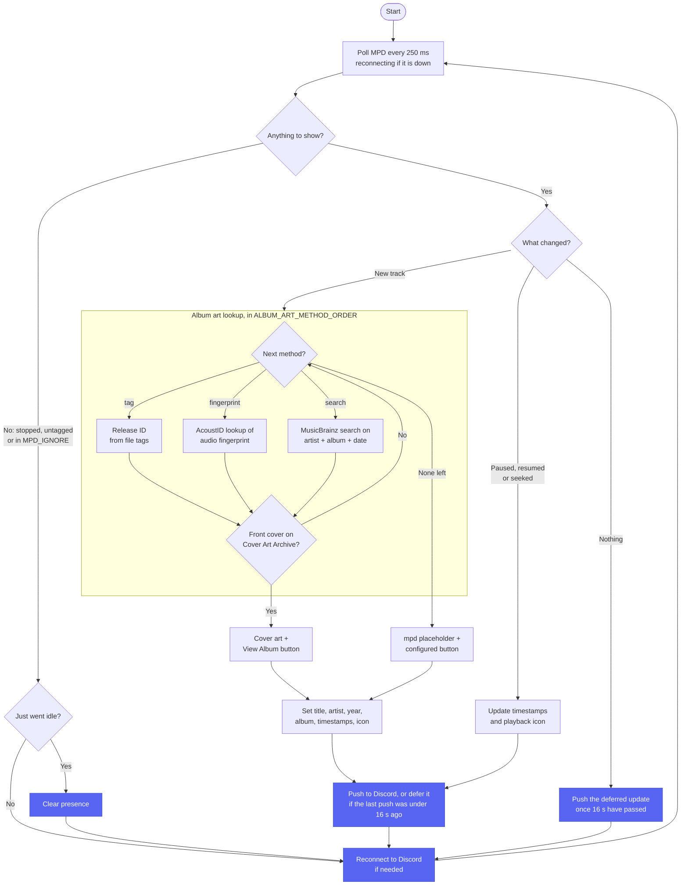

# MPD-Presence

A Discord Rich Presence client for [MPD](https://www.musicpd.org/) (Music Player Daemon). Automatically displays your currently playing track on your Discord profile, complete with album art fetched from MusicBrainz / Cover Art Archive.

| Voice channel | User activity |
|:---:|:---:|
|  |  |

---

## Features

- Displays track title, artist(s), album, and release year in Discord
- Album art lookup via **MusicBrainz IDs in your tags**, **AcoustID fingerprint** and/or **MusicBrainz text search**
- "View Album" button linking to the MusicBrainz release page when art is found
- Optional second configurable Discord button
- Optional playing / paused small icon
- Seek, pause/resume, and idle state detection
- Path-based ignore list to suppress presence for specific library folders
- Discord rate-limit aware — deferred updates are flushed automatically
- Automatic reconnect to both MPD and Discord (e.g. after either restarts)

---

## How It Works



Blue steps talk to Discord. Presence updates are sent at most once every 16 s to stay within Discord's rate limit; a change that comes sooner is held and sent once that window has passed.

---

## Configuration

All configuration is done at compile time. Copy the template, then edit your copy:

```bash
cp include/config.hpp.example include/config.hpp
```

`include/config.hpp` is git-ignored, so your personal settings — including your
MPD password — are never committed. Edit it, then rebuild the project for changes
to take effect.

### Album art methods

`ALBUM_ART_METHOD_ORDER` is a comma-separated list of methods, tried in order until one finds art:

| Method | Uses | Notes |
|---|---|---|
| `tag` | `MUSICBRAINZ_ALBUMID` / `MUSICBRAINZ_RELEASEGROUPID` tags | Exact and instant for libraries tagged with [Picard](https://picard.musicbrainz.org/). Release-group IDs need libmpdclient ≥ 2.22. |
| `fingerprint` | AcoustID lookup of the audio fingerprint | MPD decodes the file to compute it, so it only runs when this method is reached. |
| `search` | MusicBrainz search on artist + album + date | Needs all three tags. |

### Playing / paused icon

Set `SMALL_IMAGE_PLAYING` and `SMALL_IMAGE_PAUSED` to show a small icon on the album art. Each value is either the key of an
asset uploaded to your Discord application (Developer Portal → Rich Presence → Art Assets) or an image URL. Leave them empty for no icon.

### AcoustID API Key

The AcoustID client key used for fingerprint lookups is set via `ACOUSTID_API_KEY` in `include/config.hpp`. Replace the default with your own key from [acoustid.org/login](https://acoustid.org/login) if needed.

---

## Dependencies

| Library | Purpose |
|---|---|
| [libmpdclient](https://www.musicpd.org/libs/libmpdclient/) | MPD communication + Chromaprint fingerprinting |
| [discord-presence](https://github.com/EclipseMenu/discord-presence) | Discord Rich Presence (Modern C++ rewrite) |
| [libcurl](https://curl.se/libcurl/) | HTTP requests (MusicBrainz, AcoustID, Cover Art Archive) |
| [nlohmann/json](https://github.com/nlohmann/json) | JSON parsing |
| [cpp-logger](https://github.com/jayng9663/cpp-logger) | CPP Logger |

---

## Build

```bash
mkdir build && cd build
cmake ..
make
```

`nlohmann/json` is found automatically via CMake or pkg-config. If neither is available, place a copy of the single-header `nlohmann/json.hpp` under `third_party/nlohmann/json.hpp`.

---

## Running

```bash
./MPD-Presence [OPTIONS]

Options:
  -v, --verbose   Enable DEBUG-level logging
  -h, --help      Show this message
```

The process runs in the foreground. Stop it with `Ctrl+C` or `SIGTERM`.

---

## Album Art Resolution

When a track changes, the methods in `ALBUM_ART_METHOD_ORDER` run **synchronously**, in order, before the presence update is pushed:

- **`tag`**: take the release ID from the file's tags and check **Cover Art Archive** for a front image (`/front-500`). If that release has no art, use the release group's art instead.
- **`fingerprint`**: query **AcoustID** with the Chromaprint fingerprint, then check Cover Art Archive for each matching release.
- **`search`**: run a **MusicBrainz text search** on the first artist + album + date (score threshold 100), then check Cover Art Archive for the best match.

The first method that finds art wins. If none does, the default `mpd` placeholder image is used.

If `BUTTON1LABEL`/`BUTTON1URL` are set, the first button becomes **"View Album"** (linking to the MusicBrainz release page) for tracks where art was found, and shows your configured button for all other tracks.

MusicBrainz search results and Cover Art Archive checks are cached in memory for the lifetime of the process, so repeated lookups for the same album are free. Network errors are not cached, so a failed check is retried on the next track from that album.
