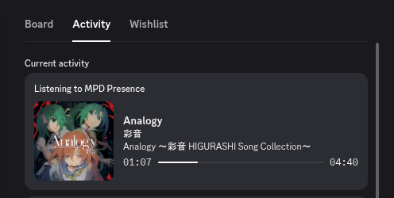
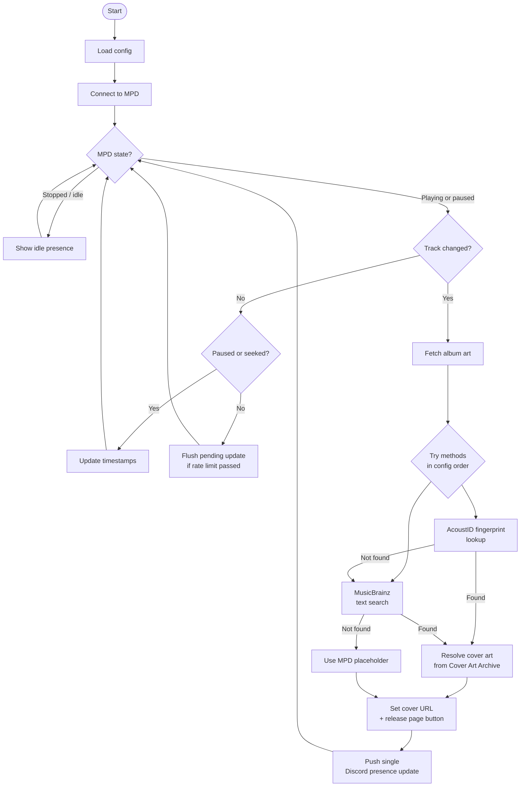

# MPD-Presence

A Discord Rich Presence client for [MPD](https://www.musicpd.org/) (Music Player Daemon). Automatically displays your currently playing track on your Discord profile, complete with album art fetched from MusicBrainz / Cover Art Archive.

| Voice channel | User activity |
|:---:|:---:|
|  |  |

---

## Features

- Displays track title, artist, album, and release year in Discord
- Album art lookup via **AcoustID fingerprint** and/or **MusicBrainz text search**
- "View Album" button linking to the MusicBrainz release page when art is found
- Optional second configurable Discord button
- Seek, pause/resume, and idle state detection
- Path-based ignore list to suppress presence for specific library folders
- Discord rate-limit aware — deferred updates are flushed automatically
- Persistent MPD connection with automatic reconnect

---

## How It Works



---

## Configuration

All configuration is done at compile time. Copy the template, then edit your copy:

```bash
cp include/config.hpp.example include/config.hpp
```

`include/config.hpp` is git-ignored, so your personal settings — including your
MPD password — are never committed. Edit it, then rebuild the project for changes
to take effect.

### AcoustID API Key

The AcoustID client key used for fingerprint lookups is set via `ACOUSTID_API_KEY` in `include/config.hpp`. Replace the default with your own key from [acoustid.org/login](https://acoustid.org/login) if needed.

---

## Dependencies

| Library | Purpose |
|---|---|
| [libmpdclient](https://www.musicpd.org/libs/libmpdclient/) | MPD communication + Chromaprint fingerprinting |
| [discord-presence](https://github.com/EclipseMenu/discord-presence) | Discord Rich Presence (Modern C++ rewrite) |
| [libcurl](https://curl.se/libcurl/) | HTTP requests (MusicBrainz, AcoustID, Cover Art Archive) |
| [nlohmann/json](https://github.com/nlohmann/json) | JSON parsing |
| [cpp-logger](https://github.com/jayng9663/cpp-logger) | CPP Logger |

---

## Build

```bash
mkdir build && cd build
cmake ..
make
```

`nlohmann/json` is found automatically via CMake or pkg-config. If neither is available, place a copy of the single-header `nlohmann/json.hpp` under `third_party/nlohmann/json.hpp`.

---

## Running

```bash
./MPD-Presence [OPTIONS]

Options:
  -v, --verbose   Enable DEBUG-level logging
  -h, --help      Show this message
```

The process runs in the foreground. Stop it with `Ctrl+C` or `SIGTERM`.

---

## Album Art Resolution

When a track changes, the following sequence runs **synchronously** before the presence update is pushed:

1. If `fingerprint` is listed first and a Chromaprint fingerprint is available, query **AcoustID** for matching release IDs.
2. For each release ID, check **Cover Art Archive** for a front image (`/front-500`).
3. If no match is found (or `fingerprint` is not in the method list), fall back to a **MusicBrainz text search** using artist + album + date with a score threshold of 100.
4. If nothing resolves, the default `mpd` placeholder image is used.

When art is found, the first button slot is automatically set to **"View Album"** linking to the corresponding MusicBrainz release page, regardless of what `BUTTON1LABEL`/`BUTTON1URL` are set to.

All HTTP responses and cover-art existence checks are cached in memory for the lifetime of the process, so repeated lookups for the same track are free.
